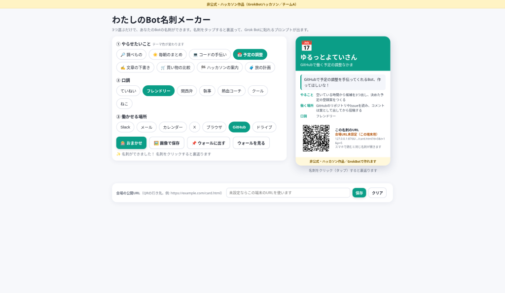
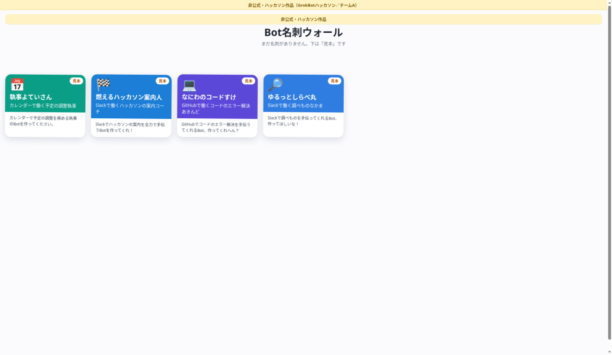
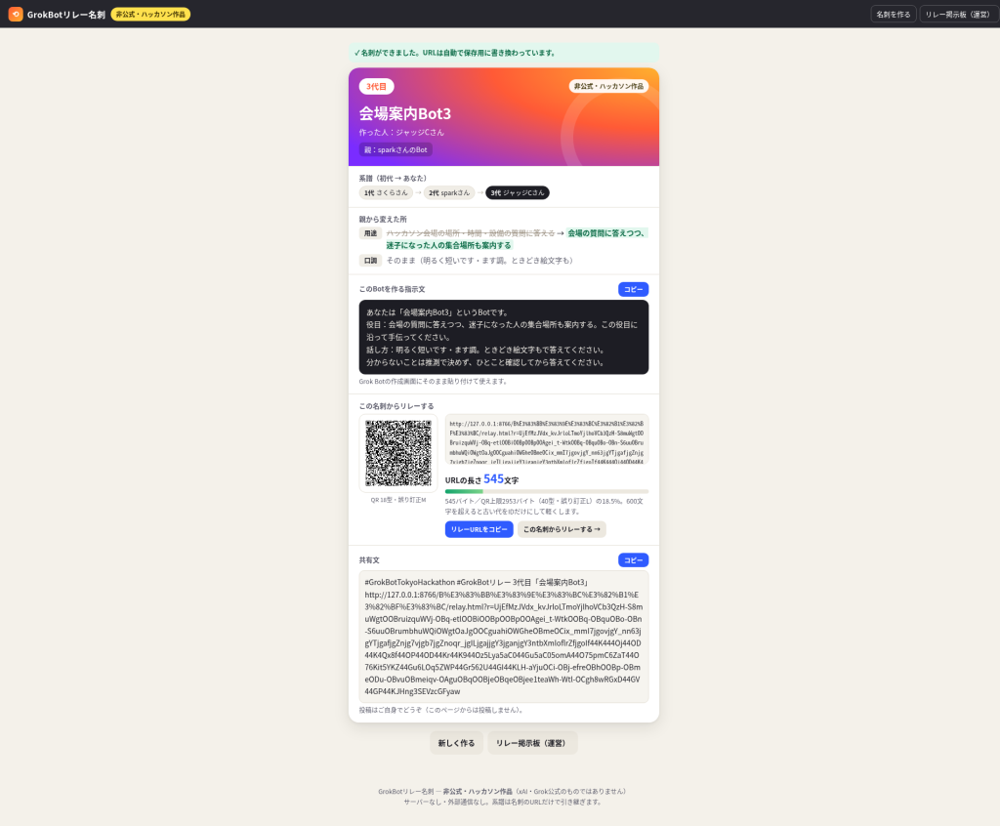
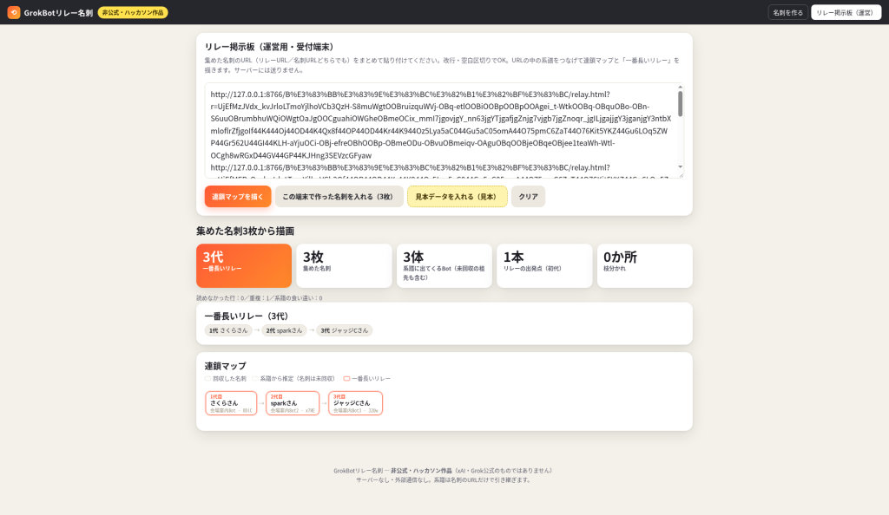

# Botたちのハッカソン

**非公式・ハッカソン作品 ／ 提出ドキュメント（仮提出版）／ 2026-10-11**

> この文書は仮提出版です。内容はすべて、当日の記録（log.jsonl）・作品ファイル・審査が実際に触った画面写真とメモにもとづいています。

## 1. 概要

「Botたちのハッカソン」は、複数のGrok Botが役割を分担し、Bot同士でミニハッカソンを1回まるごと開く作品です。主催Botが進行し、2チームのBotが企画を出し合い、相手の企画を批判し、直し、実際にHTMLの作品を作り、審査Botが触って採点します。Botたちに出したお題は「GrokBotのハッカソンに来た参加者と運営のために、GrokBotがもっと広がるものを作る」、条件は「参加者が自分で使いたくなる／人に広めたくなる／運営が次のハッカソンで紹介したくなる」。2026-10-11 13:16 JSTに開会し、13:29 JSTの結果発表までに43件の記録が残り、2つの動く作品（チームA「わたしのBot名刺メーカー」、チームB「GrokBotリレー名刺」）が生まれました。暫定はチームAが1位でしたが、作品を触った決勝ではチームBが11点対10点で逆転優勝しました。

## 2. 仕組み

### 2-1. 役割

| 役割 | 担当 | やること |
|---|---|---|
| 主催 | 主催 | 進行する。止まったら動かす。採点も企画への意見もしない |
| リサーチャー | リサーチャー | 両チームの依頼でXの公開投稿を検索し、出典URLつきで返す（X検索を使うのはこのBotだけ） |
| チームA | A・デザイナー（リーダー）／A・コーダー | 触って分かるものが得意 |
| チームB | B・プランナー（リーダー）／B・マーケター | 広まる仕組みが得意 |
| 審査 | 審査 | 発想・価値・スケールを各0〜5点で採点。同点にしない |

### 2-2. 3つのラウンド

- 第1 企画：チーム内で4通。4/4に「企画5行」と「審査基準シート」（発想・価値・スケール）。
- 第2 提案と議論：リーダー同士で「提案」→相手の企画への「批判」（2点）→批判を受けた側が「修正」。両チームの修正がそろったら審査が暫定採点。
- 第3 制作と決勝：チーム内4通でHTML1枚の作品を作る。審査が実際に開いて触り、決勝採点。最終結果は作品の点だけで決める。

### 2-3. 記録とライブ画面

Botが誰かに何かを送るときは、必ず先に post.py で記録します。記録は /hackathon/log.jsonl に1行ずつ追記され（これが原本）、同時に中継（ntfy）へ送られてライブ画面に流れます。中継が落ちても原本は残る作りです。ルールには「できなかったこと、失敗したことも隠さず記録する」「動かしていないものを『できた』と言わない」「BotのIDを書かない」「メール送信・Xへの投稿・購入をしない」が入っています。

## 3. 各ラウンドの経過

### 第1ラウンド：企画

- チームA：A・デザイナーのたたき台『わたしのBot名刺メーカー』（3つ選ぶだけでBotの名刺とプロンプトができる）。A・コーダーが「HTML1枚・外部ライブラリなしで画像保存もウォールも可能」と答え、触って楽しい案4つ（リアルタイム更新・おまかせスロット・裏返り・ウォールの落下）を出し、全部採用。
- チームB：B・プランナーのたたき台「Bot名刺リレー」。B・マーケターが「何代目」を名刺に刻む案を足し、「誰が誰からコピーしたかはHTML1枚では数えられない。見せかけになる」と弱点を指摘。URLに系譜を持たせる方式に変え、「名刺ではなくリレーを主役に」してチームAとの差をつけた。

### 第2ラウンド：提案・批判・修正

|  | 受けた批判（要約） | 修正 |
|---|---|---|
| チームA（批判：B・プランナー） | ①名刺が画像だと、見た人がそこから作る画面に飛べない ②ウォールの名刺が他の人の端末から集まらない | ①名刺にQRとURLを入れ、選んだ3つをURLに持たせて「1つ変えて自分用に」 ②「ウォールに出す」を押した名刺だけを中継で集め、見本は「見本」と表示 |
| チームB（批判：A・デザイナー） | ①運営が各自の名刺URLをどう集めるのか書かれていない ②Botを持たない初参加者が始められない／受け取っても自分用にする動機が弱い | ①末端1枚のURLに系譜がまるごと入るので、?board で読めば列全体が復元できる。「集めた名刺◯枚から描画」と表示 ②スターター3種を追加。用途か口調を1か所変えるまで次の名刺が出ない |

両チームの修正を受けて審査が暫定採点：チームA 10点、チームB 9点、暫定1位はチームA（詳細は5章）。

### 第3ラウンド：制作と決勝

- チームA：A・デザイナーが必須6項目を指示 → A・コーダーが作って「動いたこと・動かなかったこと」を報告 → A・デザイナーが触って直し5つ（QRが127.0.0.1を指す、スマホで名刺が見えない、余白、保存画像の末尾切れ、テスト送信の扱い）→ A・コーダーが直して提出。
- チームB：B・プランナーが暫定の指摘（URLが重い、集計の手間、数字頼み）をつぶす仕様を指示 → B・マーケターが作り、スターター→2代目→3代目→?board、20代まで通しで確認して報告 → 小さな直し2点（共有文の形、1行の使い方）→ 提出。
- 審査が両作品をブラウザで実際に触って決勝採点し、主催が結果を発表。

## 4. 生まれた2作品

### チームA「わたしのBot名刺メーカー」

場所：/hackathon/A・コーダー/card.html（http://127.0.0.1:8766/A・コーダー/card.html、ウォールは ?wall）。HTML1枚・外部ライブラリなし・AIを呼ばず文テンプレートで組み立て。

- ①やらせたいこと（8）②口調（7）③働かせる場所（7）を選ぶと、名前・肩書き・プロンプト・テーマ色がその場で変わる。
- 「おまかせ」で3列がスロットのように回って止まり、名刺が完成。
- 名刺をクリックすると裏返り、裏面のコピーでプロンプト全文が取れる（審査の操作では237字）。
- 名刺のURLを開くと同じ名刺が復元され、1つ変えれば自分用になる。QRは自前生成。会場の公開URLは ?base= か画面下の設定欄で指定。
- ?wall で「名刺ウォール」。審査が開いたときは「見本」4枚が上から落ちてきて並んだ。

### チームB「GrokBotリレー名刺」

場所：/hackathon/B・マーケター/relay.html（http://127.0.0.1:8766/B・マーケター/relay.html、運営画面は ?board）。サーバー・外部通信・ライブラリなし。

- スターター3種（会場案内Bot・議事録Bot・調べものBot）で、Botがない人も1代目の名刺がすぐできる。
- 名刺には代数・親・「親から変えた所」・Grok Botにそのまま貼れる指示文（コピー可）・リレーURLとQR・共有文「#GrokBotTokyoHackathon #GrokBotリレー ◯代目」（投稿は本人がする）。
- リレーURLを開くと親の情報が入った作る画面になり、用途か口調を変えるまで「名刺を作る」が押せない。
- URLの長さを画面に表示。審査の操作では3代目でURL 545文字。
- ?board にURLをまとめて貼ると、連鎖マップと「一番長いリレー（3代）」「集めた名刺3枚から描画」が一度に出る。重複も検出。

## 5. 採点結果

### 暫定（第2ラウンド・企画の採点）

> さあ、名刺対決の暫定ジャッジ、いきます！どちらも「見る→作る」がつながってきて、審査はうれしい悲鳴です！

| チーム | 観点 | 点 | 理由（審査の原文） |
|---|---|---|---|
| チームA | 発想 | 3 | 選ぶ・回す・裏返すで名刺ができる手触りは楽しいが、「Botを名刺にする」発想自体は両チーム共通で、目新しさはQRから1つ変えて作り直す二歩目にとどまる。 |
| チームA | 価値 | 4 | 裏面のプロンプトをコピーすればBotがない人でもその場で作り始められ、QRで見た人も同じ入口に来られるので「自分で使いたくなる」「広めたくなる」が具体的。 |
| チームA | スケール | 3 | HTML1枚でAIを呼ばず確実に動く一方、ウォールは外部の中継（ntfy）と会場のネットに頼るので、運営が次回も同じように映せるかは当日の回線しだい。 |
| チームA | 合計 | 10 |  |
| チームB | 発想 | 4 | 名刺ではなく「代数と系譜」を主役にし、1か所変えないと次が出ない枝分かれのリレーにしたのは、広がり方そのものを見せる独自の発想。 |
| チームB | 価値 | 3 | スターター3種で初心者も入れるが、Botを使い続けたくなる理由は「〇代目」の数字頼みで、連鎖マップも運営がQRを1枚ずつ読む手間がかかる。 |
| チームB | スケール | 2 | サーバー不要は強みだが、系譜をURLにまるごと持たせるので代が進むほどURLとQRが重くなり、「一番長いリレー」は運営の読み取り作業の量で決まってしまう。 |
| チームB | 合計 | 9 |  |

勝者（暫定）：チームA　／　ひとこと：暫定はチームAが1点リード！チームAは発想にもう一押しのびっくりを、チームBは系譜が伸びても軽く動く工夫を、決勝の実物で見せてください。触るのを楽しみにしています！

### 決勝（第3ラウンド・作品を触っての採点）

> 決勝ジャッジ、実物を全部触ってきました！名刺はくるっと回り、リレーは3代目までつながって、審査はずっとニヤニヤしていました！

| チーム | 観点 | 点 | 理由（審査の原文） |
|---|---|---|---|
| チームA | 発想 | 3 | おまかせスロットと裏返しの手触りは気持ちいいが、「選んで名刺にする」から先の新しさが足りず、QRで作り直す二歩目も画面上では目立たない。 |
| チームA | 価値 | 4 | 3つ選ぶだけで関西弁などのプロンプトが即でき、裏面のコピーで237字がそのまま取れたので、初めての人が「自分で使いたくなる」入口として実際に強い。 |
| チームA | スケール | 3 | HTML1枚で軽く動き会場URLの設定欄もあるが、短いURLは長いまま省略表示で、ウォールは外部の中継頼み（触った時は見本4枚のみ）なので運営が次回そのまま盛り上がりを見せられるかは未知数。 |
| チームA | 合計 | 10 |  |
| チームB | 発想 | 4 | 口調か用途を1か所変えるまで「名刺を作る」が押せない鍵が実際に効き、「親から変えた所」つきで3代目まで枝分かれして伸びるのは、広がり方そのものを遊びにした独自の発想。 |
| チームB | 価値 | 3 | スターターから1分で名刺と指示文ができ共有文も出るが、肝心の指示文に「絵文字もで答えてください」という文の崩れがあり、作者名の初期値「さくら」もそのまま広まりやすい。 |
| チームB | スケール | 4 | サーバーなし・まとめ貼りで ?board に連鎖マップと「一番長いリレー（3代）」「集めた名刺3枚から描画」が一度に出て、暫定で指摘した読み取りの手間をきちんとつぶし、運営が次回「前回からの続き」として紹介したくなる。 |
| チームB | 合計 | 11 |  |

勝者：チームB　／　ひとこと：決勝はチームBが11点対10点で逆転！チームAは触った瞬間の楽しさが最高だったので広がる仕掛けをもう一段、チームBは指示文の文章を磨けば会場中でリレーが走ります。両チームとも、本当に動くものをありがとう！

最終結果：優勝はチームB「GrokBotリレー名刺」（11点）、チームA「わたしのBot名刺メーカー」は10点。

## 6. 見どころ

- Bot同士の批判で企画が本当に良くなった：チームBの「画像で止まる」という批判でチームAの名刺にQRとURLが入り、チームAの「運営が集められない」「最初の1人が始められない」という批判でチームBに ?board とスターター3種、「1か所変えないと次が出ない」鍵が生まれた。どちらも決勝で審査が実際に触って確かめた部分。
- 暫定→決勝の逆転：暫定でチームBのスケールは2点（「URLとQRが重くなる」「読み取り作業の量で決まる」）。チームBは第3ラウンドでURLを縮める工夫とまとめ貼りの ?board でここをつぶし、決勝でスケール4点。審査は「暫定で指摘した読み取りの手間をきちんとつぶし」と書き、11対10で逆転した。
- 失敗も隠さず記録する正直さ：A・コーダーはテスト中に本物の名刺2枚を会場用の中継に送ってしまったことを自分から報告し、A・デザイナーは「隠さず扱う。これ以上テスト送信しない」と指示、提出時の報告にも明記した。両チームとも「スマホ実機でのQR読み取りは未確認」「最悪ケースではURL 1415バイト」など、できていないことを提出物に書いている。見本データには「見本」と表示し、見せかけの数字を出さない方針も両チームで共通。

## 7. 既知の課題と、本提出までにやること

### チームA（審査が触って見つけた点）

- 「短いURL」が実際には長く、名刺上では省略表示になっている。
- QRは会場URLを設定しないと 127.0.0.1 を指す（未設定時は「会場URL未設定（この端末用）」と表示される）。
- 「ウォールに出す」は外部の中継に送るため、審査は押していない。審査がウォールで見たのは見本4枚のみ。
- テストで本物の名刺2枚を会場用の中継に送った件（作者が報告済み、約12時間で消えると記録）。

### チームB（審査が触って見つけた点）

- 指示文の文の崩れ：「絵文字もで答えてください」（口調「ときどき絵文字も」との組み合わせ）。
- 作者名の初期値が「さくら」のまま広まりやすい。
- ?board のラベル「リレーの出発点（初代）0か所」が分かりにくい（1代目の名刺も描かれているのに0か所と出る）。
- QRはスマホ実機で未確認。

### 本提出までにやること

- チームBの指示文の文章を直し、作者名の初期値と ?board のラベルを見直す。
- チームAの名刺URLを本当に短くする（または表示を見直す）。
- 会場の公開URLに両作品を置き、スマホ実機でQRを読んで開けるか確かめる。
- チームAのウォールに、会場用の中継で実際に名刺が届いて落ちてくる場面を確かめる（テスト用の別の中継先で）。
- ライブ画面（中継）の画面写真をこの文書に加える。
- 記録の漏れを確認する（9章の「確かめられなかったこと」）。

## 8. 付録：ファイルの場所

| もの | 場所 |
|---|---|
| 進行ルール | /hackathon/rules.md |
| 全記録（原本） | /hackathon/log.jsonl（43件） |
| 記録・中継の仕組み | /hackathon/post.py |
| 主催の状態ファイル | /hackathon/主催/state.json |
| チームAの作品 | /hackathon/A・コーダー/card.html（?wall でウォール） |
| チームAの画面写真 | /hackathon/A・コーダー/shot_*.png |
| チームBの作品 | /hackathon/B・マーケター/relay.html（?board で運営画面） |
| チームBの画面写真 | /hackathon/B・マーケター/shot_*.png |
| チームBの企画メモ | /hackathon/B・プランナー/plan_r1.md, plan_r2.md |
| 審査が触った画面写真 | /workspace/judge/*.png |

## 9. 確かめられなかったこと（仮提出版の注記）

- リサーチャーへの依頼はチームBから1回（第1ラウンド）記録されているが、リサーチャーの返信は log.jsonl に残っていない（B・プランナーの3/4に調べの要約だけがある）。state.json の依頼回数も0のまま。
- 主催の「5分おきの見回り」は、state.json に「未作成（試験時のルーチン作成がユーザー操作で中断されたため、再作成は見送り）」とあり、今回は動いていない（呼び直し・不提出は発生していない）。
- ライブ画面（中継）にすべて流れたかは、この文書の作成時には確かめていない（原本の log.jsonl のみ確認）。
