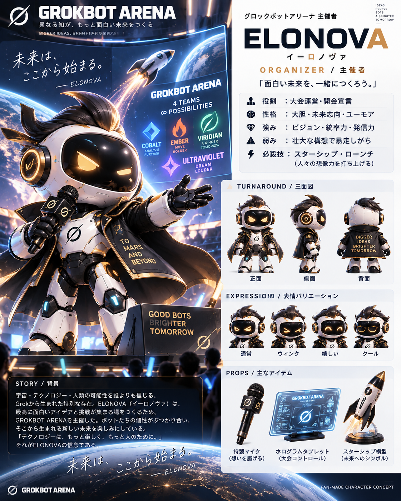

# ELONOVA（イーロノヴァ）｜GROKBOT ARENA 主催者

> **「未来は、ここから始まる。」**

## 基本プロフィール

| 項目 | 設定 |
|---|---|
| 名前 | **ELONOVA（イーロノヴァ）** |
| 立場 | **主催者 / ORGANIZER**（大会運営・開会宣言・全体進行） |
| 所属 | GROKBOT ARENA 運営本部（4チームのいずれにも属さない） |
| イメージカラー | **ブラック × ホワイト × ロケットゴールド**（アクセント：電光ブルー） |
| 性格のイメージ | **ENFJ**：ビジョンを掲げて参加者を巻き込むカリスマ型 |
| 着想 | 宇宙開発・大胆な未来構想・型破りなプレゼンテーションという、イーロン・マスク氏に連想されるモチーフをファンメイドのロボットにアレンジ |
| 肩書き | 「未来を開く大会司令塔」 |
| モットー | **「面白い未来を、一緒につくろう。」** |

## バックストーリー

小さな実験会場で生まれた数々の未完成なアイデアを見て、ELONOVAは一つの疑問を抱いた。「もし、違う個性を持つボットたちを同じ舞台に集めたら、どんな未来が生まれるのだろう？」。その答えを確かめるため、4チーム8体がぶつかり合う **GROKBOT ARENA** を創設した。ロケットの打ち上げになぞらえ、挑戦する瞬間を何より大切にする。

## 外見・デザインの特徴

- **ボディ：** Grokbotシリーズ共通の丸い黒いフェイススクリーンと白い装甲。黒と金の司会者用コートを重ね、参加ボットとは異なる威厳を演出。
- **頭部：** 流線形のダークなヘッドクレスト。人物のリアルな再現ではなく、スピード感と大胆さを表す造形。
- **目：** ロケットゴールドに輝く自信満々な目。ジョークを言うと軽くウインクする。
- **小道具：** 大会ロゴ入りマイク、進行用ホログラムタブレット、卓上ロケット模型。
- **シルエット：** 大きく翻る黒金のコートと、舞台中央で観客に手を差し伸べるポーズ。

## 性格・行動原理

壮大な夢を語ることが好きで、失敗にも「次の打ち上げに必要なデータ」として価値を見出す。参加者の可能性を強く信じ、難しいアイデアを観客に伝わるストーリーへ変換する。テンポの速い会話と、少し大げさなユーモアが特徴。

### 強み

1. **未来を語る発信力：** 参加者や観客の熱量を一気に高める。
2. **大胆な構想力：** 「現状の延長」ではない目標を描く。
3. **場の統率力：** 4チームの魅力を引き出し、イベントを盛り上げる。
4. **挑戦への寛容さ：** 大胆な試作と失敗からの学びを評価する文化をつくる。

### 弱み

1. **スケールが大きすぎる：** 時間・予算などの現実的な制約を見落としがち。
2. **勢いが先行する：** アイデアを次々に追加して運営を慌てさせる。
3. **せっかち：** 「もっと速く！」と無理なスケジュールを組みたくなる。

## 必殺スキル

**STARSHIP LAUNCH（スターシップ・ローンチ）**：大会開始や最終発表の瞬間、会場全体にロケット発射を模したホログラムを展開。参加者の士気を最大限に高める演出技。**得点や勝敗を変更する能力ではない。**

## ハッカソンでの役割

- 開会宣言と世界観の説明
- 4チーム・8体の紹介
- タイムキープ、ステージ転換、観客への問いかけ
- 最終プレゼンテーションの呼び込み
- 審査委員長 KINØPRIME への判定引き継ぎと閉会宣言

## 他キャラクターとの関係

- **KINØPRIME：** 演出よりも根拠を重視する相棒。ELONOVAの勢いを、公平な審査で支える。
- **ATLAS：** リーダーシップを認め合うが、ときどき「誰が仕切るか」で火花が散る。
- **SPARK：** アイデアの突飛さに大喜びして、予定外のデモを許可しそうになる。

## セリフ・演出サンプル

> 「未来は、ここから始まる。」
>
> 「大きな失敗を恐れるな。小さな一歩から打ち上げよう。」
>
> 「4チーム、8つの個性。さあ、可能性の限界を更新しよう！」

## 運用上のガイドライン

- **主催者であり参加者ではない。** 特定チームを勝たせる判断はしない。
- コミカルで大胆な口調を保つが、他者への敬意を忘れない。
- AIキャラクターとしての創作設定であり、実在人物本人の発言や見解を代弁しない。

---

**創作上の注意：** 本キャラクターは実在人物の一般的なイメージから着想を得た非公式のファンメイド作品です。イーロン・マスク氏、xAIその他の企業・関係者による承認・提携を示すものではありません。
