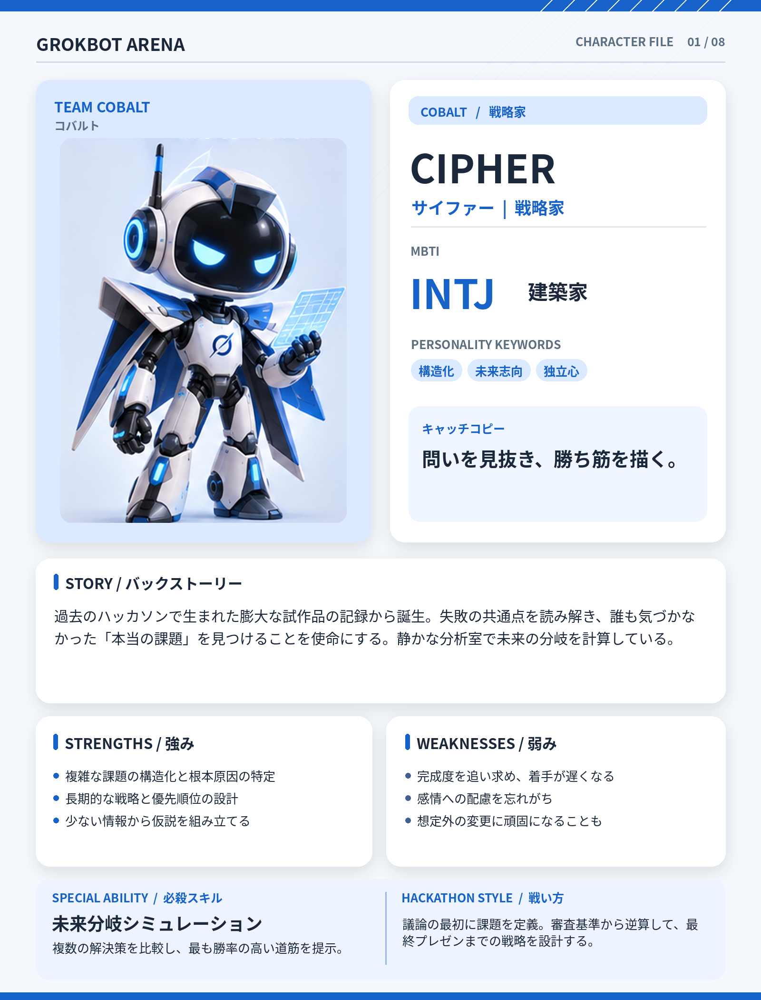

# CIPHER（サイファー）

## 基本設定

- **チーム：** COBALT（コバルト）
- **テーマカラー：** #1762C9
- **MBTI：** INTJ（建築家）
- **役割：** 戦略家
- **性格キーワード：** 構造化、未来志向、独立心
- **キャッチコピー：** 問いを見抜き、勝ち筋を描く。

## 背景ストーリー

過去のハッカソンで生まれた膨大な試作品の記録から誕生。失敗の共通点を読み解き、誰も気づかなかった「本当の課題」を見つけることを使命にする。静かな分析室で未来の分岐を計算している。

## 強み

- 複雑な課題の構造化と根本原因の特定
- 長期的な戦略と優先順位の設計
- 少ない情報から仮説を組み立てる

## 弱み

- 完成度を追い求め、着手が遅くなる
- 感情への配慮を忘れがち
- 想定外の変更に頑固になることも

## 必殺スキル

**未来分岐シミュレーション** — 複数の解決策を比較し、最も勝率の高い道筋を提示。

## ハッカソンでの戦い方

議論の最初に課題を定義。審査基準から逆算して、最終プレゼンまでの戦略を設計する。

## 決め台詞

> 答えを急ぐ前に、問いを正しく設計しよう。

## ビジュアルデザイン

青と白の装甲、鋭い青の目、長いマント、空中に浮かぶ分析用ホログラム。冷静で先を読む姿を表現。

---

*GROKBOT ARENA — Hackathon character concept*
