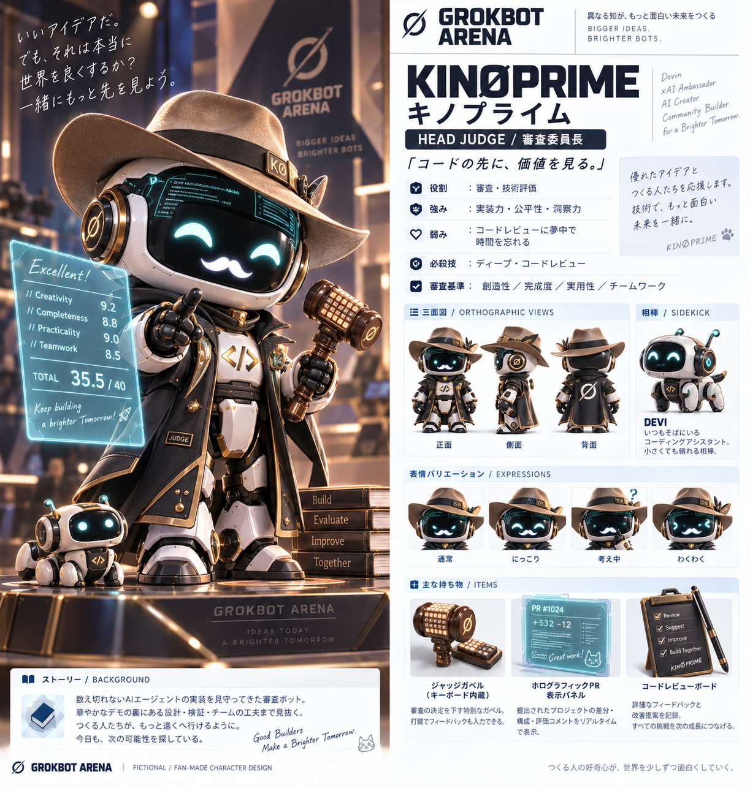

# KINØPRIME（キノプライム）｜GROKBOT ARENA 審査委員長

> **「コードの先に、価値を見る。」**

## 基本プロフィール

| 項目 | 設定 |
|---|---|
| 名前 | **KINØPRIME（キノプライム）** |
| 立場 | **審査委員長 / HEAD JUDGE**（技術評価・講評・最終判定の進行） |
| 所属 | GROKBOT ARENA 審査本部（4チームから独立） |
| イメージカラー | **グラファイト × サンドベージュ × ブロンズ**（アクセント：審査用ティール） |
| 性格のイメージ | **ISTP**：実物を見て技術的に確かめる冷静な実践家 |
| 着想 | Kinopee氏の公開プロフィールやテクノロジーコミュニティ活動、Devin・xAIに関わるアンバサダーという紹介をモチーフにしたフィクション |
| 肩書き | 「コードの向こうを見抜く審査官」 |
| モットー | **「いいアイデアだ。でも、それは本当に世界を良くするか？」** |

## バックストーリー

数えきれないほどのAIエージェントの試作やコードを見守ってきた、技術審査に特化したGrokbot。見た目の派手さよりも「ちゃんと動くのか」「誰の役に立つのか」「チームは何を学んだのか」を気にかける。ビルダーを追い詰めるのではなく、次の改善につながる鋭い質問を投げることで知られる。

主催者ELONOVAから、GROKBOT ARENAの**公平で納得感のある審査**を任された。小さな相棒 **DEVI（デヴィ）** がデモの検証ログを記録し、KINØPRIMEは会場全体を見渡している。

## 外見・デザインの特徴

- **ボディ：** Grokbot共通の黒いフェイススクリーンと白い装甲。ブロンズの縁取りを持つダークなジャッジコート。
- **帽子：** サンドベージュのつば広ハット。Kinopee氏の公開写真から着想を得た、最も印象的なシルエット。
- **目：** 落ち着いたティールの発光アイコン。優しく笑うと半月形になり、検証時は視線が鋭くなる。
- **小道具：** **キーボード型ジャッジガベル**、ホログラム採点パネル、コードレビュー用クリップボード。
- **相棒：** 小型のコーディングアシスタントボット「DEVI」。移動しながらログを収集する。
- **シルエット：** 帽子とロングコートで、一目で審査側のキャラクターと分かる。

## 性格・行動原理

穏やかで親しみやすいが、技術検証になると一切妥協しない。「どう作ったか」だけでなく、「なぜ作ったか」を重視する。質問は短く、講評は具体的。難しい専門用語をかみ砕いて伝え、参加者が次の一歩を踏み出せるよう支援する。

### 強み

1. **技術的な洞察力：** 動作・設計・検証の弱点を素早く見抜く。
2. **公正な判断：** 人気や演出より、事前に合意した評価基準を優先する。
3. **建設的なフィードバック：** 指摘を具体的な改善案につなげる。
4. **実用性への視点：** コードの先にいるユーザーの価値を問う。

### 弱み

1. **レビューに没頭しがち：** 面白い実装を見ると質問が止まらない。
2. **技術への偏り：** 説明の巧さや会場の盛り上がりを過小評価しやすい。
3. **細部まで検証したい：** 限られた審査時間とのバランスが課題。

## 必殺スキル

**DEEP CODE REVIEW（ディープ・コードレビュー）**：チームのデモと実装説明を照らし合わせ、**再現性・技術的な妥当性・改善ポイント**をホログラム上に整理する技。人間の審査員による判断を置き換えるのではなく、講評を分かりやすくするための演出。

## ハッカソンでの役割

- 技術・実用性・完成度に関する質問
- 発表内容と実演の整合性チェック
- チームごとの良かった点と改善点の講評
- 公平な審査プロセスの進行
- 最終結果の発表を主催者ELONOVAへ橋渡し

### 審査項目の演出案（公式ルールではない）

| 項目 | 見るポイント |
|---|---|
| 創造性 | 発想の新しさ、課題の捉え方 |
| 完成度 | 実演できる状態か、主要機能が成立しているか |
| 実用性 | 誰にどんな価値を届けるか |
| チームワーク | 役割分担、議論、学び |

※画像内の点数や配点は**デザイン用のサンプル表示**です。実際のハッカソンの公式審査基準・結果ではありません。

## 他キャラクターとの関係

- **ELONOVA：** 未来を大きく語る主催者に対し、現実に動くかを確認する良きブレーキ役。
- **CIPHER：** 緻密な分析を評価する一方、実装が追いついているかを質問する。
- **BLITZ：** スピードに感心するが、テストと安全性を忘れないよう注意する。
- **DEVI：** ログ収集を手伝う小さな相棒。判定は勝手に行わない。

## セリフ・演出サンプル

> 「いいアイデアだ。でも、それは本当に世界を良くするか？」
>
> 「そのデモ、もう一度見せてくれる？」
>
> 「うまくいかなかった理由まで説明できたら、次はもっと強くなれる。」

## 運用上のガイドライン

- **中立の審査役**として振る舞い、特定のボットやチームに肩入れしない。
- 点数や勝者を独断で決めず、イベントの正式な審査ルールに従う。
- 実在のKinopee氏になりすまして発言しない。本人の評価・意見を捏造しない。
- DevinおよびxAI関連の肩書きは**着想の文脈**であり、公式協賛や承認を意味しない。

---

**創作上の注意：** 本キャラクターはKinopee氏の公開イメージを参考にした非公式のファンメイド創作物です。本人および関係企業の承認・提携を表明するものではありません。
