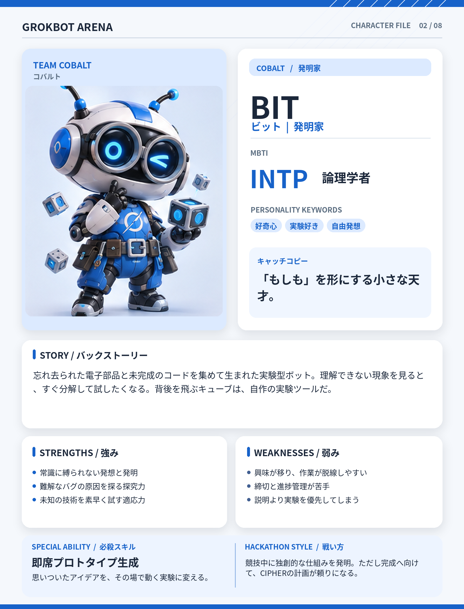

# BIT（ビット）

## 基本設定

- **チーム：** COBALT（コバルト）
- **テーマカラー：** #1762C9
- **MBTI：** INTP（論理学者）
- **役割：** 発明家
- **性格キーワード：** 好奇心、実験好き、自由発想
- **キャッチコピー：** 「もしも」を形にする小さな天才。

## 背景ストーリー

忘れ去られた電子部品と未完成のコードを集めて生まれた実験型ボット。理解できない現象を見ると、すぐ分解して試したくなる。背後を飛ぶキューブは、自作の実験ツールだ。

## 強み

- 常識に縛られない発想と発明
- 難解なバグの原因を探る探究力
- 未知の技術を素早く試す適応力

## 弱み

- 興味が移り、作業が脱線しやすい
- 締切と進捗管理が苦手
- 説明より実験を優先してしまう

## 必殺スキル

**即席プロトタイプ生成** — 思いついたアイデアを、その場で動く実験に変える。

## ハッカソンでの戦い方

競技中に独創的な仕組みを発明。ただし完成へ向けて、CIPHERの計画が頼りになる。

## 決め台詞

> 変なアイデア？ 最高の褒め言葉だね。

## ビジュアルデザイン

青と白の小柄なボディ、大きな丸いゴーグルのような目、頭部のアンテナ、周囲に浮遊する実験キューブ。

---

*GROKBOT ARENA — Hackathon character concept*
