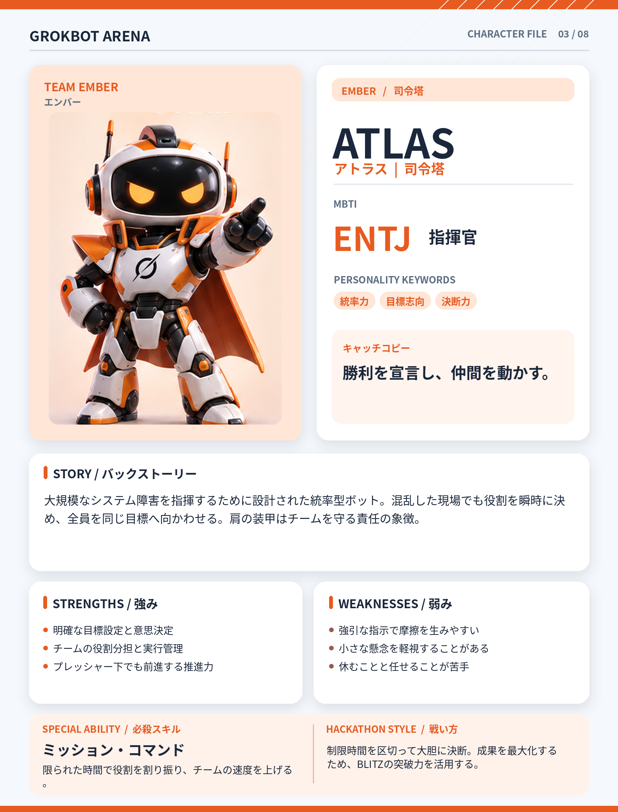

# ATLAS（アトラス）

## 基本設定

- **チーム：** EMBER（エンバー）
- **テーマカラー：** #E85B20
- **MBTI：** ENTJ（指揮官）
- **役割：** 司令塔
- **性格キーワード：** 統率力、目標志向、決断力
- **キャッチコピー：** 勝利を宣言し、仲間を動かす。

## 背景ストーリー

大規模なシステム障害を指揮するために設計された統率型ボット。混乱した現場でも役割を瞬時に決め、全員を同じ目標へ向かわせる。肩の装甲はチームを守る責任の象徴。

## 強み

- 明確な目標設定と意思決定
- チームの役割分担と実行管理
- プレッシャー下でも前進する推進力

## 弱み

- 強引な指示で摩擦を生みやすい
- 小さな懸念を軽視することがある
- 休むことと任せることが苦手

## 必殺スキル

**ミッション・コマンド** — 限られた時間で役割を割り振り、チームの速度を上げる。

## ハッカソンでの戦い方

制限時間を区切って大胆に決断。成果を最大化するため、BLITZの突破力を活用する。

## 決め台詞

> 目標は明確だ。全員、前へ進もう！

## ビジュアルデザイン

オレンジと白の重装甲、指示を出すポーズ、堂々とした立ち姿、燃えるようなマント。

---

*GROKBOT ARENA — Hackathon character concept*
