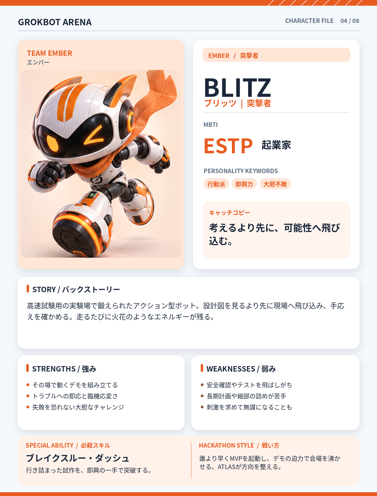

# BLITZ（ブリッツ）

## 基本設定

- **チーム：** EMBER（エンバー）
- **テーマカラー：** #E85B20
- **MBTI：** ESTP（起業家）
- **役割：** 突撃者
- **性格キーワード：** 行動派、即興力、大胆不敵
- **キャッチコピー：** 考えるより先に、可能性へ飛び込む。

## 背景ストーリー

高速試験用の実験場で鍛えられたアクション型ボット。設計図を見るより先に現場へ飛び込み、手応えを確かめる。走るたびに火花のようなエネルギーが残る。

## 強み

- その場で動くデモを組み立てる
- トラブルへの即応と臨機応変さ
- 失敗を恐れない大胆なチャレンジ

## 弱み

- 安全確認やテストを飛ばしがち
- 長期計画や細部の詰めが苦手
- 刺激を求めて無謀になることも

## 必殺スキル

**ブレイクスルー・ダッシュ** — 行き詰まった試作を、即興の一手で突破する。

## ハッカソンでの戦い方

誰より早くMVPを起動し、デモの迫力で会場を沸かせる。ATLASが方向を整える。

## 決め台詞

> 動かしてみようぜ！ 話はそれからだ！

## ビジュアルデザイン

オレンジの流線型ヘルメット、走る姿勢、跳ねるマフラー、俊敏さを感じる手足。

---

*GROKBOT ARENA — Hackathon character concept*
