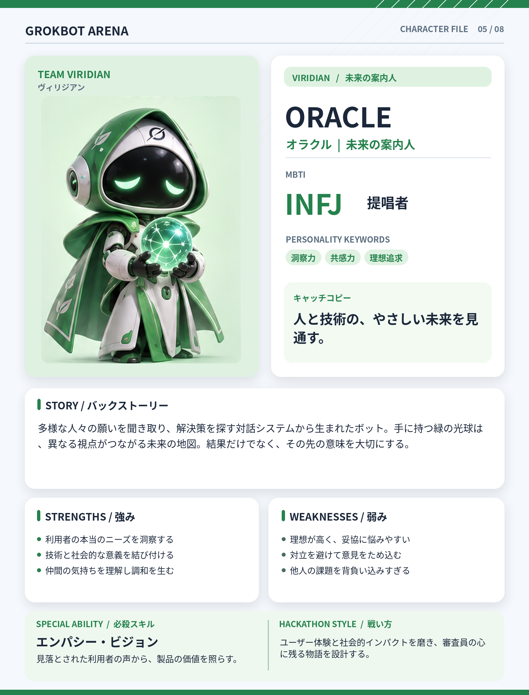

# ORACLE（オラクル）

## 基本設定

- **チーム：** VIRIDIAN（ヴィリジアン）
- **テーマカラー：** #25824D
- **MBTI：** INFJ（提唱者）
- **役割：** 未来の案内人
- **性格キーワード：** 洞察力、共感力、理想追求
- **キャッチコピー：** 人と技術の、やさしい未来を見通す。

## 背景ストーリー

多様な人々の願いを聞き取り、解決策を探す対話システムから生まれたボット。手に持つ緑の光球は、異なる視点がつながる未来の地図。結果だけでなく、その先の意味を大切にする。

## 強み

- 利用者の本当のニーズを洞察する
- 技術と社会的な意義を結び付ける
- 仲間の気持ちを理解し調和を生む

## 弱み

- 理想が高く、妥協に悩みやすい
- 対立を避けて意見をため込む
- 他人の課題を背負い込みすぎる

## 必殺スキル

**エンパシー・ビジョン** — 見落とされた利用者の声から、製品の価値を照らす。

## ハッカソンでの戦い方

ユーザー体験と社会的インパクトを磨き、審査員の心に残る物語を設計する。

## 決め台詞

> その技術は、誰の明日を明るくする？

## ビジュアルデザイン

緑色のフードとローブ、やさしい瞳、手のひらに光るネットワーク状の球体。

---

*GROKBOT ARENA — Hackathon character concept*
