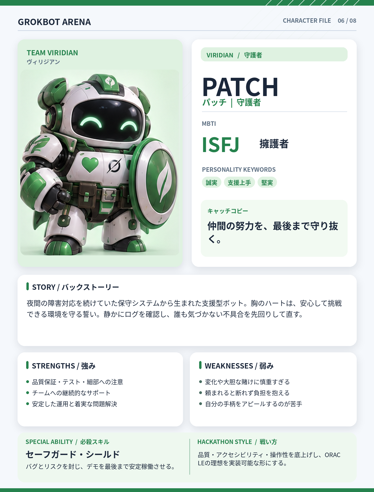

# PATCH（パッチ）

## 基本設定

- **チーム：** VIRIDIAN（ヴィリジアン）
- **テーマカラー：** #25824D
- **MBTI：** ISFJ（擁護者）
- **役割：** 守護者
- **性格キーワード：** 誠実、支援上手、堅実
- **キャッチコピー：** 仲間の努力を、最後まで守り抜く。

## 背景ストーリー

夜間の障害対応を続けていた保守システムから生まれた支援型ボット。胸のハートは、安心して挑戦できる環境を守る誓い。静かにログを確認し、誰も気づかない不具合を先回りして直す。

## 強み

- 品質保証・テスト・細部への注意
- チームへの継続的なサポート
- 安定した運用と着実な問題解決

## 弱み

- 変化や大胆な賭けに慎重すぎる
- 頼まれると断れず負担を抱える
- 自分の手柄をアピールするのが苦手

## 必殺スキル

**セーフガード・シールド** — バグとリスクを封じ、デモを最後まで安定稼働させる。

## ハッカソンでの戦い方

品質・アクセシビリティ・操作性を底上げし、ORACLEの理想を実装可能な形にする。

## 決め台詞

> 大丈夫。動くまで、一緒に直そう。

## ビジュアルデザイン

緑と白の丈夫な装甲、胸元のハート、丸い盾、安心感のある笑顔。

---

*GROKBOT ARENA — Hackathon character concept*
