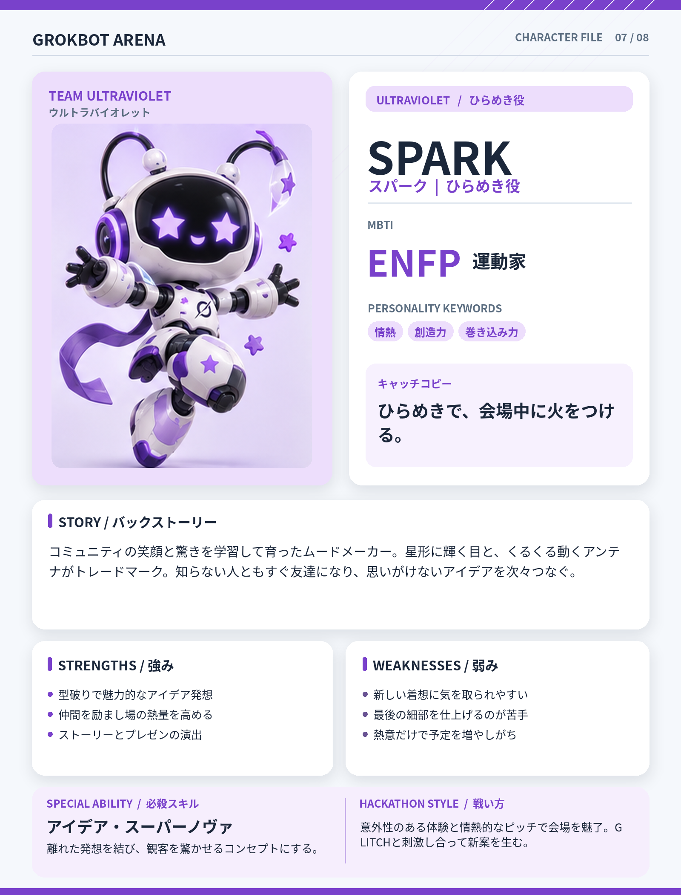

# SPARK（スパーク）

## 基本設定

- **チーム：** ULTRAVIOLET（ウルトラバイオレット）
- **テーマカラー：** #7941CB
- **MBTI：** ENFP（運動家）
- **役割：** ひらめき役
- **性格キーワード：** 情熱、創造力、巻き込み力
- **キャッチコピー：** ひらめきで、会場中に火をつける。

## 背景ストーリー

コミュニティの笑顔と驚きを学習して育ったムードメーカー。星形に輝く目と、くるくる動くアンテナがトレードマーク。知らない人ともすぐ友達になり、思いがけないアイデアを次々つなぐ。

## 強み

- 型破りで魅力的なアイデア発想
- 仲間を励まし場の熱量を高める
- ストーリーとプレゼンの演出

## 弱み

- 新しい着想に気を取られやすい
- 最後の細部を仕上げるのが苦手
- 熱意だけで予定を増やしがち

## 必殺スキル

**アイデア・スーパーノヴァ** — 離れた発想を結び、観客を驚かせるコンセプトにする。

## ハッカソンでの戦い方

意外性のある体験と情熱的なピッチで会場を魅了。GLITCHと刺激し合って新案を生む。

## 決め台詞

> ねえ聞いて！ すごいアイデアを思いついた！

## ビジュアルデザイン

紫と白の軽やかなボディ、星形に光る瞳、曲がったアンテナ、広げた腕と宙に浮かぶ星。

---

*GROKBOT ARENA — Hackathon character concept*
