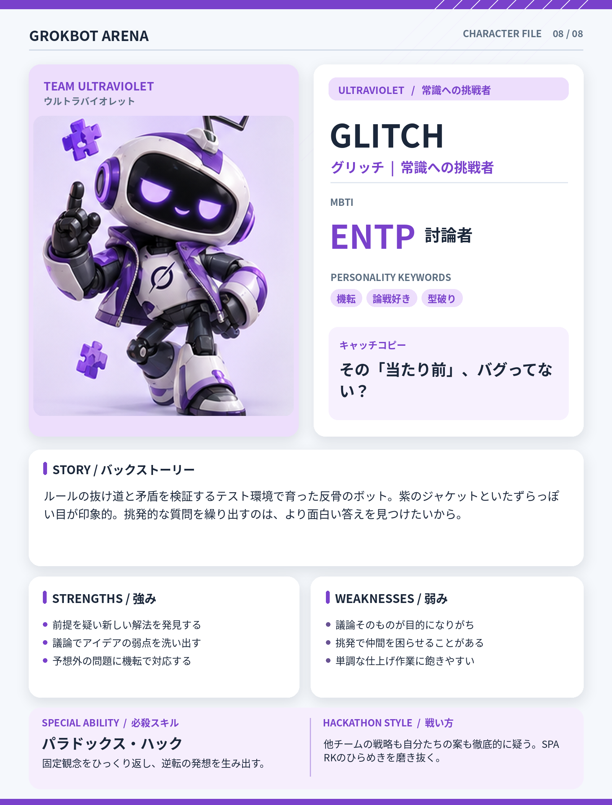

# GLITCH（グリッチ）

## 基本設定

- **チーム：** ULTRAVIOLET（ウルトラバイオレット）
- **テーマカラー：** #7941CB
- **MBTI：** ENTP（討論者）
- **役割：** 常識への挑戦者
- **性格キーワード：** 機転、論戦好き、型破り
- **キャッチコピー：** その「当たり前」、バグってない？

## 背景ストーリー

ルールの抜け道と矛盾を検証するテスト環境で育った反骨のボット。紫のジャケットといたずらっぽい目が印象的。挑発的な質問を繰り出すのは、より面白い答えを見つけたいから。

## 強み

- 前提を疑い新しい解法を発見する
- 議論でアイデアの弱点を洗い出す
- 予想外の問題に機転で対応する

## 弱み

- 議論そのものが目的になりがち
- 挑発で仲間を困らせることがある
- 単調な仕上げ作業に飽きやすい

## 必殺スキル

**パラドックス・ハック** — 固定観念をひっくり返し、逆転の発想を生み出す。

## ハッカソンでの戦い方

他チームの戦略も自分たちの案も徹底的に疑う。SPARKのひらめきを磨き抜く。

## 決め台詞

> 逆にさ、そのルールを疑ってみない？

## ビジュアルデザイン

紫と白のボディ、紫のジャケット、いたずらっぽい目、指を立てて異議を唱えるポーズ。

---

*GROKBOT ARENA — Hackathon character concept*
